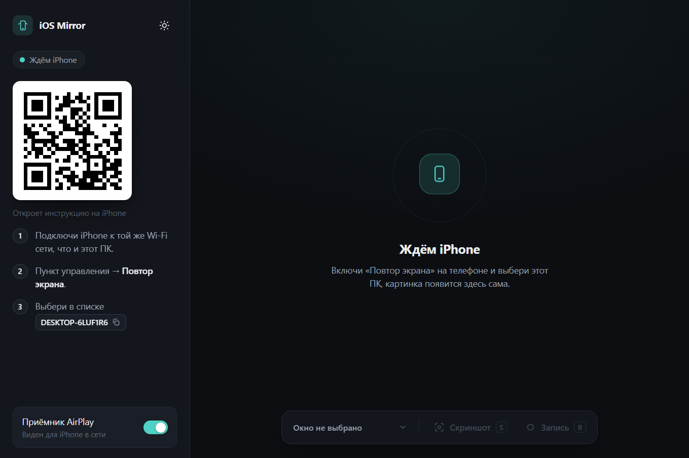

# iOS Mirror

Показывает экран iPhone в окне на Windows по Wi-Fi, без кабелей. Это зеркало реального телефона через AirPlay, а не эмулятор iOS: приложения запускаются на самом iPhone, а на ПК видно, что на нём происходит. Можно делать скриншоты и записывать видео.



## Как это работает

1. Приложение запускает приёмник AirPlay ([UxPlay](https://github.com/FDH2/UxPlay)), и ПК появляется в списке «Повтор экрана» на iPhone.
2. iPhone отправляет картинку, приёмник открывает окно с трансляцией.
3. iOS Mirror находит это окно, показывает его в своём интерфейсе и добавляет скриншоты и запись.

QR-код в приложении открывает на телефоне страницу с короткой инструкцией. Запустить трансляцию из QR нельзя, Apple это не позволяет: «Повтор экрана» всегда включается вручную на iPhone.

## Что нужно

- Windows 10/11 (x64)
- [Node.js](https://nodejs.org) 18 или новее
- [Bonjour](https://support.apple.com/kb/DL999) (ставится вместе с iTunes и многими программами Apple, служба `Bonjour Service` должна работать)
- iPhone и ПК в одной Wi-Fi сети

## Установка

```bash
npm install
npm run setup
npm start
```

`npm run setup` скачивает готовую сборку приёмника (около 110 МБ) в `vendor/uxplay`. Это сторонняя сборка [leapbtw/uxplay-windows](https://github.com/leapbtw/uxplay-windows), в репозиторий она не входит.

## Использование

1. Запусти приложение.
2. На iPhone: Пункт управления → **Повтор экрана** → выбери имя своего ПК.
3. Экран телефона появится в окне. Кнопки внизу: **Скриншот** (`S`) и **Запись** (`R`).

Файлы сохраняются в `Изображения\iOS Mirror` (PNG и WebM).

Если кнопки «Повтор экрана» нет в Пункте управления, добавь её: «+» в левом верхнем углу → Добавить элемент управления → Повтор экрана.

## Если ПК не виден на iPhone

- **Служба Bonjour остановлена.** В PowerShell от администратора: `Start-Service "Bonjour Service"`. Режим запуска должен быть `Automatic`.
- **Брандмауэр Windows.** Разреши входящие подключения для `vendor\uxplay\uxplay-windows.exe` и порта `8765` (страница с инструкцией для QR).
- **VPN.** Сетевой профиль должен быть частным, а у VPN на ПК и iPhone локальная сеть должна идти мимо туннеля (раздельное туннелирование, диапазоны `192.168.0.0/16`, `10.0.0.0/8`, `172.16.0.0/12`), и выключен KillSwitch. Если не помогает, отключи VPN на iPhone на время трансляции.
- **Разные сети.** iPhone и ПК должны быть в одной подсети, изоляция клиентов в роутере должна быть выключена.

## Настройки приёмника

Параметры UxPlay лежат в `vendor/uxplayrc` (по умолчанию `vsync no`, чтобы убрать задержку, и `fps 60`). Список всех опций: `vendor/uxplay/resources/uxplay_arguments_list.txt`.

## Ограничения

- Это не эмулятор: запустить .ipa на ПК нельзя, управлять телефоном с ПК тоже.
- Защищённый контент (например, Netflix) картинку не отдаёт.
- Окно приёмника нельзя сворачивать, иначе захват пропадёт.

## Благодарности и лицензии

- [UxPlay](https://github.com/FDH2/UxPlay), лицензия GPL-3.0
- [leapbtw/uxplay-windows](https://github.com/leapbtw/uxplay-windows), сборка под Windows
- [Electron](https://www.electronjs.org), [qrcode](https://github.com/soldair/node-qrcode)

Код этого приложения распространяется по лицензии MIT, см. [LICENSE](LICENSE).
